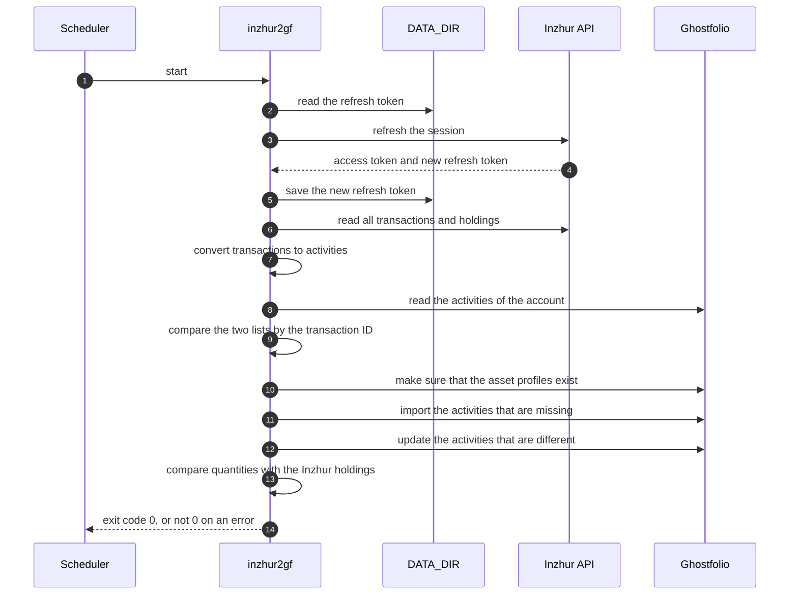

# ghostfolio-inzhur

Unofficial CLI that syncs your own [Inzhur](https://www.inzhur.reit) transactions into a
self-hosted [Ghostfolio](https://ghostfol.io).

The binary is `inzhur2gf`. It does one sync and stops. A scheduler starts it again.

> [!TIP]
> Do the first sync with `DRY_RUN=true`. The program then reports the changes, but
> Ghostfolio stores nothing.

## Disclaimer

- This project has no connection with Inzhur. Inzhur does not approve it.
- This project uses an API that has no documentation. The API can change at any time.
- You are responsible for the terms of your Inzhur account.
- The program reads only your own account. It does not do the login for you.

## How it works



Important properties:

- **One item of state.** The program keeps only the current refresh token, in `DATA_DIR`.
- **Full history on each sync.** The program reads all transactions from Inzhur and all
  activities of the account from Ghostfolio. The Inzhur transaction ID in the comment
  identifies an activity.
- **Ghostfolio follows Inzhur.** The program imports a transaction that Ghostfolio does
  not have. Inzhur can change a transaction after the import, for example its time. The
  program then updates the activity and writes the old and the new values to the log.
- **Activities only.** The program does not write market prices.
- **No automatic deletion.** The program never deletes an activity in Ghostfolio. It
  writes a warning if a transaction has two activities, or if Inzhur does not have the
  transaction of an activity.
- **Fail closed.** An unknown transaction type stops the import.

## Requirements

- An Inzhur account and a browser session that you started yourself.
- Ghostfolio 3.99.0 or later.
- A directory that stays between runs, for `DATA_DIR`.
- Go 1.27 or later, to build from source.

## Get the Inzhur refresh token

Inzhur keeps the session in a cookie named `refreshToken`. The cookie belongs to the host
`api.inzhur.reit`, not to the page of the cabinet.

> [!CAUTION]
> The refresh token gives access to your Inzhur account. Do not share it. Do not commit it.

These steps are for Firefox:

1. Open a private window.
2. Log in to the Inzhur cabinet.
3. Open `https://api.inzhur.reit/` in a new tab of the same window. An error page is normal.
4. Press F12.
5. Open **Storage** → **Cookies** → `https://api.inzhur.reit`.
6. Copy the value of `refreshToken`.
7. Close the window immediately. Do not use the logout button, because a logout stops the
   session.

> [!WARNING]
> Use the token only in one place. The open cabinet page also refreshes the session, and
> each refresh makes the previous token invalid. Thus a token from a window that stays open
> stops working after a short time.

Set the value as `INZHUR_REFRESH_TOKEN`.

The token changes on each refresh. The program saves each new token in `DATA_DIR`. It uses
`INZHUR_REFRESH_TOKEN` only for the first sync after you change the value.

If the session stops, the program exits with an error. Then do these steps again and set a
new value.

## Prepare Ghostfolio

1. Add the currency `UAH` in the admin panel.
2. Make an account for Inzhur with the currency `UAH`. Its ID is `GHOSTFOLIO_ACCOUNT_ID`.
3. Make an asset profile with the data source `MANUAL` for each Inzhur asset that you hold.
   Use the symbols from [Symbols](#symbols).
4. Get the security token of your Ghostfolio user. This is the token that you use to log
   in. Its value is `GHOSTFOLIO_ACCESS_TOKEN`.

> [!CAUTION]
> The security token gives full access to your Ghostfolio user. Keep it in a secret store.

## Configuration

The program reads its configuration from environment variables. See
[`.env.example`](.env.example).

| Variable | Required | Purpose |
|---|---|---|
| `INZHUR_REFRESH_TOKEN` | Yes | Start token from your browser session. |
| `GHOSTFOLIO_URL` | Yes | Base URL of your Ghostfolio instance, for example `http://ghostfolio:3333`. |
| `GHOSTFOLIO_ACCESS_TOKEN` | Yes | Security token of your Ghostfolio user. |
| `GHOSTFOLIO_ACCOUNT_ID` | Yes | Ghostfolio account that receives the activities. |
| `DATA_DIR` | Yes | Directory for the current refresh token. |
| `SYMBOL_MAP` | No | Ghostfolio symbol for an Inzhur asset ID. See [Symbols](#symbols). |
| `DRY_RUN` | No | `true`: the program reports the changes, but Ghostfolio stores nothing. |

If a value is missing or incorrect, the program reports all problems and exits with code 1.

## Symbols

Ghostfolio requires the prefix `GF_` for a symbol with the data source `MANUAL`.
The program makes the symbol from the Inzhur asset:

| Asset type | Rule | Example |
|---|---|---|
| Fund | `GF_` + name in capital letters, with hyphens | `GF_INZHUR-REIT` |
| Bond | `GF_` + ISIN | `GF_UA4000238976` |

Use `SYMBOL_MAP` if your asset profiles have different symbols:

```sh
SYMBOL_MAP=21=GF_INZHUR-REIT,36=GF_UA4000238976
```

The key is the Inzhur asset ID. If an asset profile is missing in Ghostfolio, the program
imports nothing and reports the symbol that it expects.

## Mapping

| Inzhur transaction | Ghostfolio activity |
|---|---|
| Purchase | `BUY` |
| Sale | `SELL` |
| Sale tax | Fee of the related `SELL` |
| Dividend crediting | `DIVIDEND` |
| Dividend tax | Fee of the related `DIVIDEND` |
| Coupon of a bond | `DIVIDEND` on the bond symbol |
| Gift | `BUY` |
| Deposit, withdrawal | Not imported |

Each activity has the comment `inzhur:<transaction id>`. The program imports only
transactions that are older than approximately one hour. Thus a dividend and its tax are
usually imported together.

> [!WARNING]
> Do not change the activities with this comment in Ghostfolio. The program finds an
> activity by its comment, and it replaces your changes on the next sync. Activities
> without this comment stay as they are.

## Build and run

```sh
go build -o inzhur2gf ./cmd/inzhur2gf

cp .env.example .env    # then set the values
set -a; . ./.env; set +a
./inzhur2gf
```

The program builds for Linux and macOS. It does not build for Windows.

### Container image

The image `ghcr.io/blobor/ghostfolio-inzhur` is for `linux/amd64` and `linux/arm64`.
It runs as a user that is not root. `DATA_DIR` is `/data` in the image.

```sh
docker run --rm --env-file .env -v inzhur2gf-data:/data ghcr.io/blobor/ghostfolio-inzhur:latest
```

Do not set `DATA_DIR` in the `.env` file for the container. If you set it, the value must
be a directory on the volume.

| Tag | Content |
|---|---|
| `edge` | Last commit on `main`. |
| `1.2.3`, `1.2`, `latest` | Release `v1.2.3`. |

Use a scheduler for regular syncs, for example cron or a Kubernetes CronJob. Make sure that
two runs do not occur at the same time.

| Exit code | Meaning |
|---|---|
| `0` | The sync was successful. |
| `1` | An error occurred. Read the log on standard error. |

## Development

```sh
git config core.hooksPath .githooks   # enable the git hooks
go test ./...
golangci-lint run
```

The hooks need [gitleaks](https://github.com/gitleaks/gitleaks). They stop a commit that
contains a secret, Go code that is not formatted, or a message that does not obey
[Conventional Commits](https://www.conventionalcommits.org/en/v1.0.0/).

## License

[MIT](LICENSE)
